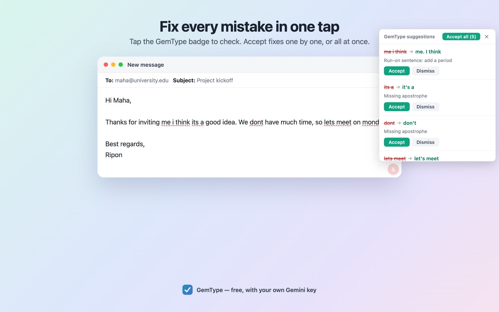
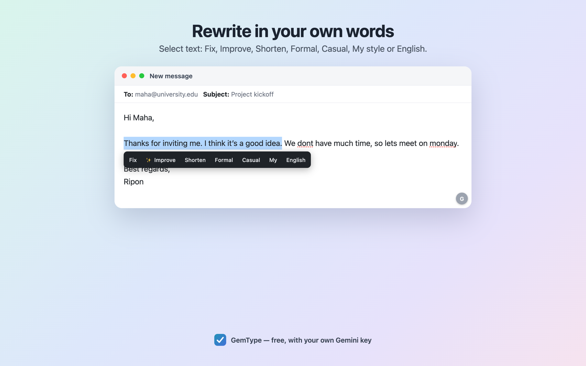
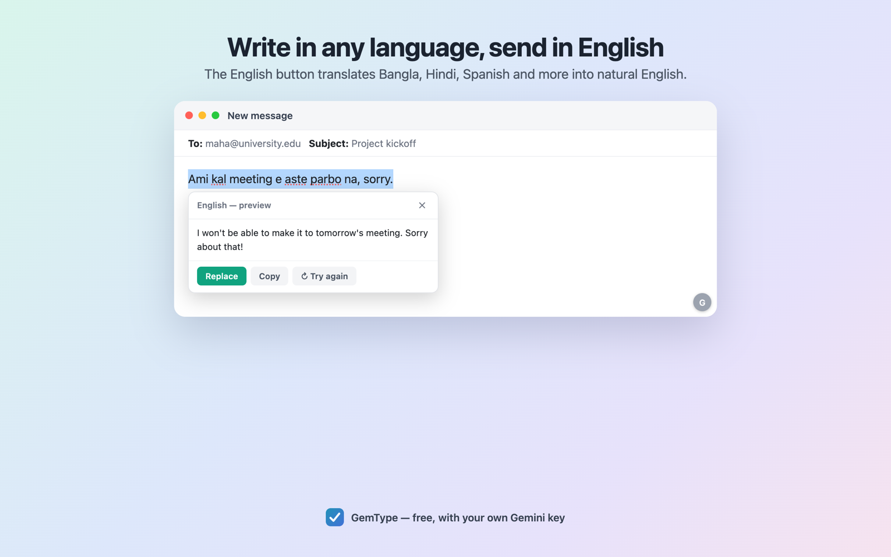
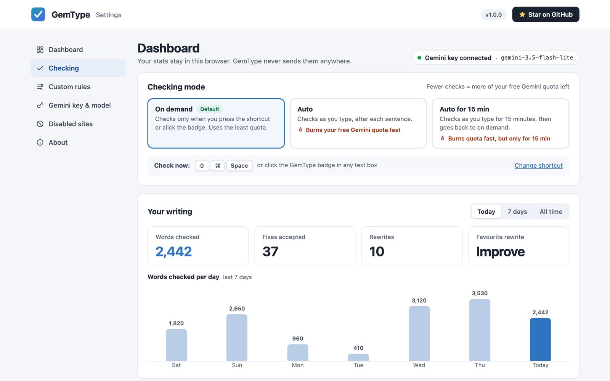

# GemType — free AI grammar checker and writing assistant

**A free, open-source Grammarly alternative. Fix grammar and spelling, rewrite, and translate to English on any website, in Microsoft Word, on your desktop, and on your phone — with your own free Gemini API key.**

### [➜ Install free: Chrome](https://chromewebstore.google.com/detail/linnnamnhkciekgpnegkcajcafmjlhgh) · [Edge](https://microsoftedge.microsoft.com/addons/detail/edbehlnmfcjhlbdlnmklicdoaopobbel) · [Firefox](https://addons.mozilla.org/firefox/addon/gemtype-ai-writing-assistant/) · [Android](https://play.google.com/store/apps/details?id=org.matily.gemtype) · [iPhone](https://apps.apple.com/app/gemtype-grammar-checker-fix/id6830512396)

**[gemtype.matily.org](https://gemtype.matily.org)** — the official site, with a live demo. · **[Join our Discord for support](https://discord.com/invite/sPc55HFsJ5)**

&nbsp;&nbsp;

---

## What is GemType?

**GemType is a free, open-source AI writing assistant and Grammarly alternative.** It checks grammar, spelling and punctuation, rewrites text in different tones, and translates any language into English — on any website, in Microsoft Word, in any desktop app, and on Android and iPhone. It runs on Google's Gemini AI using **your own free Gemini API key**, so there is no subscription, no account, and no GemType server: your text goes straight from your device to Google.

GemType is made by [Matily](https://matily.org) (Ripon Chandra Malo) and is free forever under the GPL-3.0 license.

[**▶ Watch the 2-minute tutorial on YouTube**](https://www.youtube.com/watch?v=j7Su-4hvigU)

## Get GemType

| Where you write | Get it |
|---|---|
| **Chrome** | [Chrome Web Store](https://chromewebstore.google.com/detail/linnnamnhkciekgpnegkcajcafmjlhgh) |
| **Microsoft Edge** | [Edge Add-ons](https://microsoftedge.microsoft.com/addons/detail/edbehlnmfcjhlbdlnmklicdoaopobbel) |
| **Firefox** | [Firefox Add-ons](https://addons.mozilla.org/firefox/addon/gemtype-ai-writing-assistant/) |
| **Android** (keyboard, works in every app) | [Google Play](https://play.google.com/store/apps/details?id=org.matily.gemtype) |
| **iPhone** (keyboard, works in every app) | [App Store](https://apps.apple.com/app/gemtype-grammar-checker-fix/id6830512396) |
| **Mac, Windows, Linux** (works in any app) | [Download the desktop app](../../releases/latest) |
| **Microsoft Word** | Word add-in — see [`msword/`](msword/) |
| **Safari** | Coming soon |

## Get started in 3 steps

1. **Install** GemType for your browser or phone from the links above.
2. **Get a free Gemini API key** at [aistudio.google.com/apikey](https://aistudio.google.com/apikey): sign in with Google, click **Create API key** — no credit card. Paste it on GemType's welcome page and click **Save & test**.
3. **Write anywhere.** Click the GemType badge in the corner of a text box (or press **Ctrl/⌘ + Shift + Space**) to check it, and select any text to rewrite it.

## What GemType does

- **Grammar, spelling and punctuation checking** in any text box — Gmail, LinkedIn, X, Reddit, GitHub, web mail, forums and more. Every suggestion comes with a short reason.
- **One-click fixes** — accept one fix, or **Accept all** at once. `Ctrl/⌘ + Z` always undoes.
- **Check when you want** — **On demand** (the default) checks only when you click the badge or press the shortcut, so your free quota lasts. Prefer live checking? Choose **Auto** (checks after each sentence) or **Auto for 15 min**.
- **Rewrite any text** — select it and pick:

  | Button | What it does |
  |---|---|
  | **Fix** | Fixes grammar and spelling, keeps your own words and tone |
  | **Improve** | Clearer, better-written version with the same meaning |
  | **Shorten** | Says the same thing in fewer words |
  | **Formal** | Professional tone for work and business |
  | **Casual** | Friendly, relaxed tone |
  | **My** | Rewrites it in *your* style, which you describe once in Settings |
  | **English** | Translates any language — Bangla, Hindi, Spanish, Banglish, Hinglish and more — into natural American or British English |

  Every rewrite shows a **preview** first: Replace, Copy, or Try again.
- **Custom rules** — ignore capitalization or punctuation, allow informal writing, choose US or UK spelling, or write your own rules.
- **Any language** — GemType detects the language you write in and checks it in that language.
- **Your dashboard** — words checked, fixes accepted, rewrites, a 7-day chart, and your Gemini usage and limits, counted only on your device.
- **Private by design** — no account, no tracking, no analytics; your key and settings stay on your device.

## Screenshots

| | |
|---|---|
|  |  |
| *Check your text and fix every mistake in one click* | *Select text to rewrite it in seven ways* |
|  |  |
| *Write in any language, send in English* | *Your dashboard, stored only on your device* |

## GemType vs Grammarly

| | GemType | Grammarly |
|---|---|---|
| Price | Free — with your own free Gemini key | Free plan is limited; Premium is paid monthly |
| Grammar and spelling fixes | Unlimited, with a reason for each | Full corrections need Premium |
| AI rewrites (improve, shorten, tone) | Included | Premium |
| Rewrite in your own style | Included (**My**) | — |
| Translate any language into English | Included (**English**) | — |
| Languages checked | Any language Gemini understands, auto-detected | English and a few variants |
| Account required | No | Yes |
| Tracking and analytics | None | Yes |
| Where your text goes | Google's Gemini API only, with your key | Grammarly's servers |
| Phone keyboards | Android and iPhone | Yes |
| Open source | Yes (GPL-3.0) | No |
| Google Docs | Not supported | Supported |

**What does "bring your own key" cost?** For one person, nothing: Google's free Gemini tier covers everyday writing, and GemType's On demand mode only sends text when you ask. On a paid Gemini key, a typical check costs a fraction of a cent.

## Desktop app (Mac, Windows, Linux)

The GemType desktop app works in **every application** — Word, Outlook, Slack, Notes, any editor. Select text, press **⌘⇧G** (Mac) or **Ctrl+Shift+G** (Windows/Linux), and GemType fixes or rewrites it and pastes it back.

> **[⬇ Download the desktop app](../../releases/latest)** — macOS (`.dmg`), Windows (`.exe`), Linux (`.AppImage`).

- **macOS:** open the `.dmg` and drag GemType to Applications. The first time you press the shortcut, allow **Accessibility** (System Settings → Privacy & Security → Accessibility) so GemType can copy and paste for you.
- **Windows:** run the installer. If SmartScreen appears, click **More info → Run anyway**.
- **Linux:** make the `.AppImage` executable and run it.

## Phone keyboards (Android and iPhone)

GemType is also a keyboard: tap the GemType button to fix, improve, shorten or change the tone of what you typed, **in any app** — messages, email, social media — with the same free Gemini key.

- **Android:** [Get it on Google Play](https://play.google.com/store/apps/details?id=org.matily.gemtype) (open source: [GemType-Keyboard](https://github.com/MatilyLabs/GemType-Keyboard))
- **iPhone:** [Download on the App Store](https://apps.apple.com/app/gemtype-grammar-checker-fix/id6830512396)

## Privacy

- The text you ask GemType to check is sent **only** to Google's Gemini API (`generativelanguage.googleapis.com`), with your own key. There is no GemType server.
- Your API key, settings and dashboard counts stay on your device and are never uploaded.
- Password, payment and one-time-code fields are never read.
- On Google's free tier, Google may use requests to improve its products; a paid key isn't used that way.
- Full details: [PRIVACY.md](PRIVACY.md).

## Frequently asked questions

**Is GemType really free?**
Yes. GemType is free forever and open source. It uses your own Gemini API key from Google AI Studio, which has a free tier with no credit card. There is no subscription, premium plan or ads.

**What is the best free alternative to Grammarly?**
GemType is a free, open-source Grammarly alternative that checks grammar and spelling, rewrites text in different tones, and translates to English on any website, in Word, on the desktop, and on Android and iPhone — with no account and no tracking.

**How do I get a free Gemini API key?**
Go to [aistudio.google.com/apikey](https://aistudio.google.com/apikey), sign in with a Google account, accept the terms, and click **Create API key**. Copy the key and paste it into GemType's welcome page or Settings. No credit card is needed.

**How do I check my text with GemType?**
Click the small **G** badge in the corner of the text box, or press **Ctrl + Shift + Space** (**⌘ + Shift + Space** on Mac). Mistakes are underlined and listed; click **Accept** or **Accept all**. To check automatically while you type, choose **Auto** in the GemType popup.

**Can GemType translate to English?**
Yes. Select any text and click **English**. GemType translates Bangla, Hindi, Urdu, Spanish, Arabic and many other languages — including romanized text like Banglish and Hinglish — into natural English. You choose American or British English in Settings.

**Can GemType write in my own style?**
Yes. Describe how you write once in Settings → Custom rules → **My style** (for example "friendly, short sentences, no emojis"). Then select text and click **My**.

**Is GemType safe? Where does my text go?**
Your text goes directly from your device to Google's Gemini API, using your own key. GemType has no server, no account and no analytics, so its makers never see your text. The code is open source, so anyone can check it.

**Which websites does GemType work on?**
Any website with a normal text box or rich editor, such as Gmail, LinkedIn (including the post window), X, Reddit, Microsoft Teams, GitHub, forums and blog editors. Google Docs is not supported, because Google only allows approved vendors to work inside Docs.

**Does GemType work in other languages?**
Yes. It detects the language you write in and checks it in that language — Spanish, French, German, Portuguese, Bengali, Hindi, Arabic, Chinese, Japanese and any other language Gemini understands. You can also pick a language in Settings.

**Does GemType work on iPhone and Android?**
Yes. GemType is available as a keyboard on [Android](https://play.google.com/store/apps/details?id=org.matily.gemtype) and [iPhone](https://apps.apple.com/app/gemtype-grammar-checker-fix/id6830512396) that fixes and rewrites text in any app. A Safari extension is coming soon.

**How is GemType different from pasting text into ChatGPT or Gemini?**
GemType works where you type. Mistakes are shown in place, fixes apply with one click and normal undo, and rewrites replace the selected text — no copying and pasting between tabs.

**Will GemType use up my free Gemini quota?**
Not with normal use. GemType's default **On demand** mode only sends text when you ask, it sends only the paragraphs that changed, and accepting a fix costs nothing. If Google's daily limit is ever reached, GemType tells you when it resets.

**Where can I get help with GemType?**
Join the [GemType Discord server](https://discord.com/invite/sPc55HFsJ5) for support, questions and feature ideas, or open an issue on GitHub.

**How can a website turn GemType off for a field?**
Add `data-gemtype="false"` to the field or a parent element.

## What's new in 1.0

On demand checking with **Ctrl/⌘ + Shift + Space**, **Accept all**, the new **My** and **English** rewrite buttons with a preview before anything changes, custom rules, a settings dashboard, a welcome page, LinkedIn post-window support, and a Microsoft Teams fix (thanks [@mantriyogesh](https://github.com/mantriyogesh)). Full notes on the [releases page](../../releases).

**Coming next:** GemType for Safari, and a choice of AI providers.

## Get help

Questions, problems or ideas? **[Join the GemType Discord server](https://discord.com/invite/sPc55HFsJ5)** — ask anything and get help from the community and the developer. You can also [open an issue on GitHub](../../issues).

## Contributing

Found a website where GemType doesn't work, or have an idea? [Open an issue](../../issues). Pull requests are welcome — the browser extension is in [`extension/`](extension/), the desktop app in [`desktop/`](desktop/), and the Word add-in in [`msword/`](msword/). If GemType helps you, **starring the repository** helps others find it.

## License

GemType is free and open source under the [GNU GPL v3](LICENSE), © 2026 Ripon Chandra Malo (Matily), with the additional terms in [NOTICE](NOTICE).

You can use, study, change and share the code, and your versions must stay open source under the GPL. **If you reuse GemType's code, credit it:** any copy or modified version with a user interface must show *"Based on GemType by Ripon Chandra Malo (Matily)"* with a link to this repository, for example on its About screen.

The GemType name and logo are trademarks and are not covered by the license — see [TRADEMARK.md](TRADEMARK.md). Please give forks their own name and icon.

---

Made by <b><a href="https://matily.org">Matily</a></b> — open source software studio.

